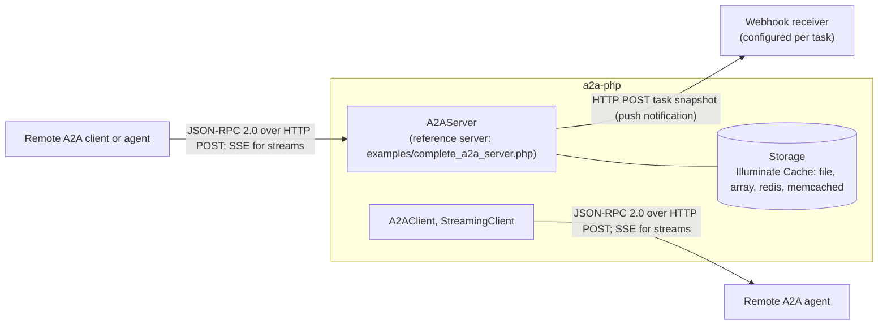
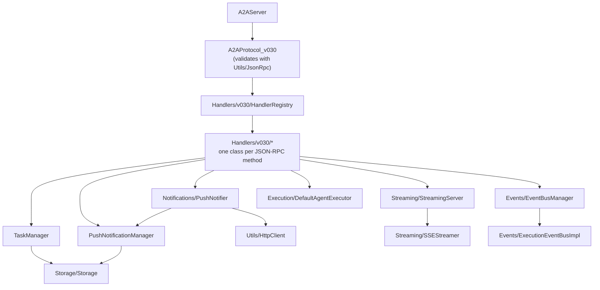

# A2A PHP Architecture

## Overview

The a2a-php SDK implements the A2A (Agent-to-Agent) Protocol in PHP.

## Diagrams

System context: who talks to the SDK, and over what.



Components inside the server path; every box is a class or folder under `src/`.



## Core Components

### 1. Protocol Models
- **AgentCard**: Protocol-compliant agent metadata with capabilities, skills, and provider info
- **Message**: Protocol-compliant messages with kind, messageId, role, and parts structure  
- **Task**: Protocol-compliant tasks with contextId, status, and artifacts
- **Parts**: TextPart, FilePart, DataPart for structured message content

### 2. Communication Layer
- **A2AClient**: HTTP client for agent-to-agent communication
- **A2AServer**: HTTP server for handling incoming requests
- **A2AProtocol_v030**: v0.3.0 entry point — validates JSON-RPC and dispatches via HandlerRegistry (`A2AProtocol` is the earlier implementation without the handler registry, kept for compatibility)
- **Handlers/v030**: One request-handler class per JSON-RPC method (MessageSendHandler, TaskGetHandler, PushConfigSetHandler, ...) mapped by HandlerRegistry
- **StreamingClient**: SSE client for real-time streaming

### 3. Streaming & Events
- **ExecutionEventBus**: Event publishing and subscription system
- **EventBusManager**: Manages multiple concurrent task streams
- **SSEStreamer**: Server-Sent Events implementation
- **StreamingServer**: Handles streaming requests with event integration

### 4. Agent Execution
- **AgentExecutor**: Interface for agent logic implementation
- **RequestContext**: Execution context with user message and task info
- **DefaultAgentExecutor**: Basic executor with lifecycle management
- **ResultManager**: Processes events and manages results

### 5. Push Notifications
- **PushNotificationManager**: Stores webhook configurations per task
- **PushNotifier**: Delivers task snapshots to configured webhooks on state changes (`X-A2A-Notification-Token` / `Authorization` headers) and enforces the optional `A2A_WEBHOOK_ALLOWLIST` SSRF guard

### 6. Error Handling
- **A2AErrorCodes**: Complete A2A protocol error codes
- **A2AException**: Base exception class
- **Specific Exceptions**: TaskNotCancelableException, etc. (one class per file under `src/Exceptions/`)

## Data Flow

```
Client Request → A2AServer → A2AProtocol_v030 → HandlerRegistry → Handler
                                                       ↓
                  EventBus ← TaskStatusUpdateEvent ← Agent Logic
                      ↓                                ↓
        SSEStreamer → Client (SSE)        PushNotifier → Webhook (HTTP POST)
```

## Key Patterns

### 1. Event-Driven Architecture
All agent execution publishes events through ExecutionEventBus for real-time updates.

### 2. Protocol Compliance
All models implement toArray()/fromArray() for JSON serialization matching A2A spec.

### 3. Streaming Support
SSE implementation allows real-time task updates and artifact streaming.

### 4. Extensibility
Interface-based design allows custom AgentExecutor implementations.

## Thread Safety

- EventBus supports concurrent task streams
- Each task gets isolated event subscription
- No shared mutable state between tasks
